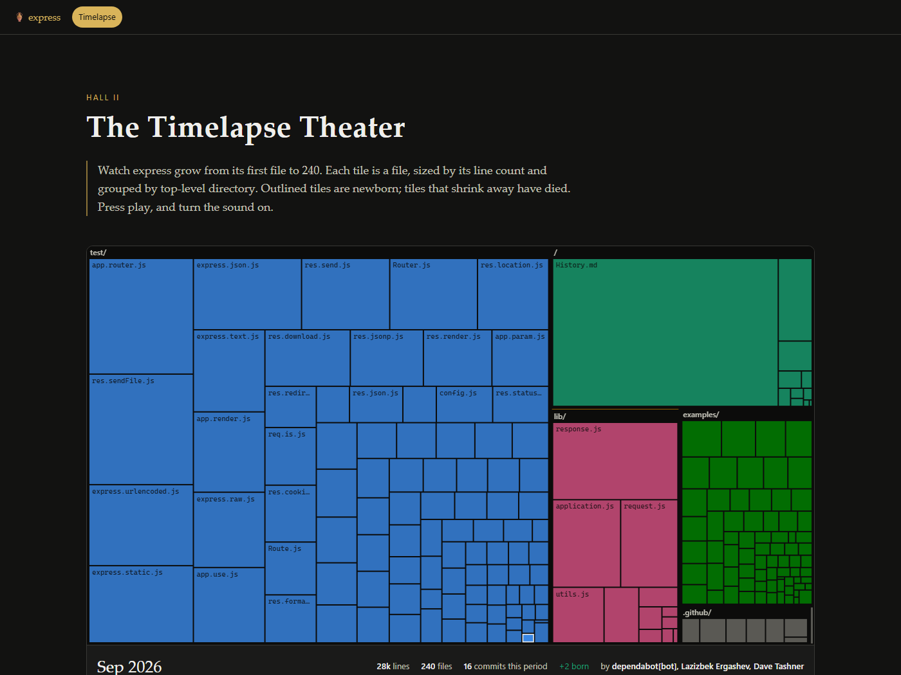
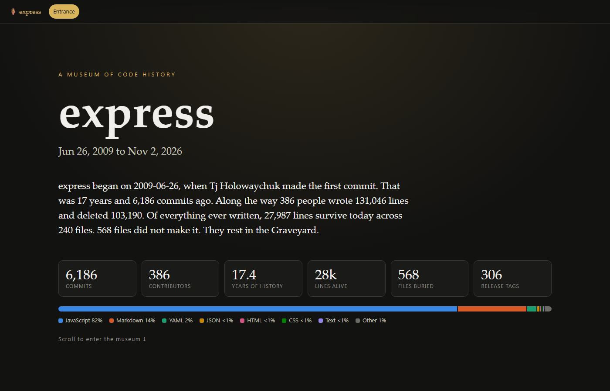
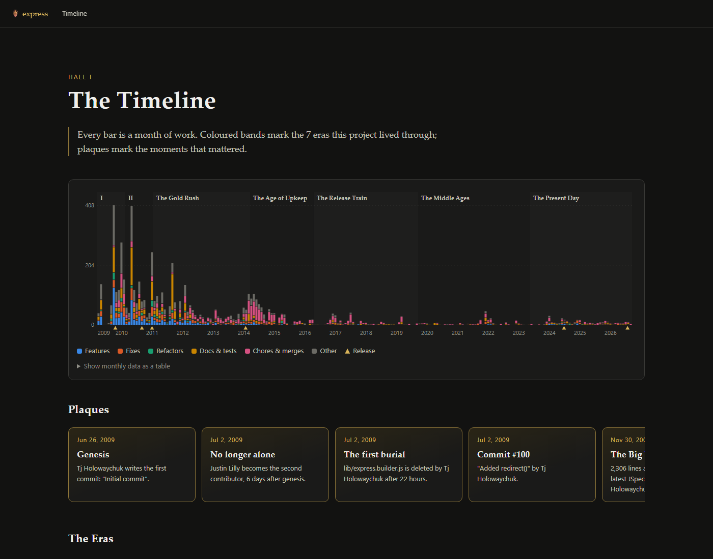
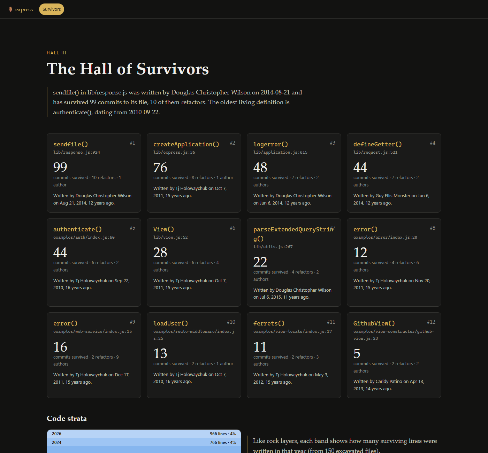
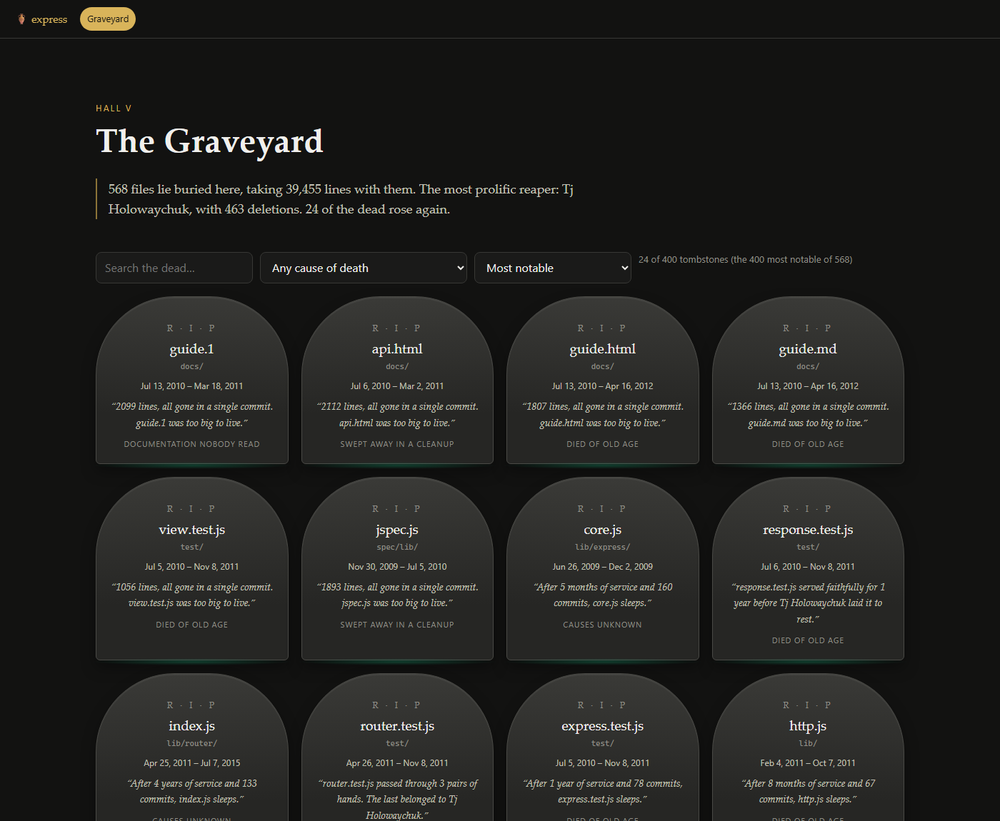
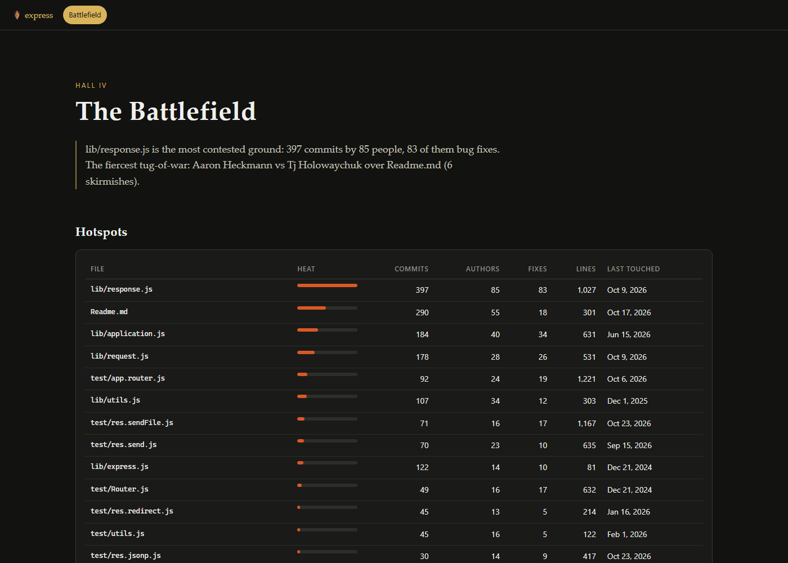
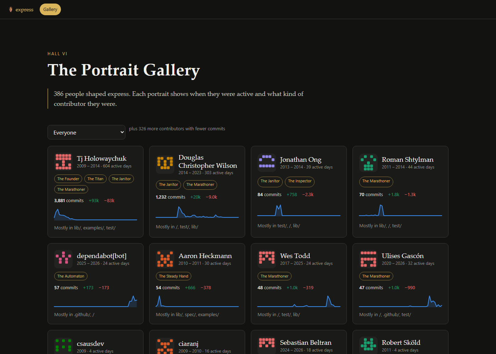
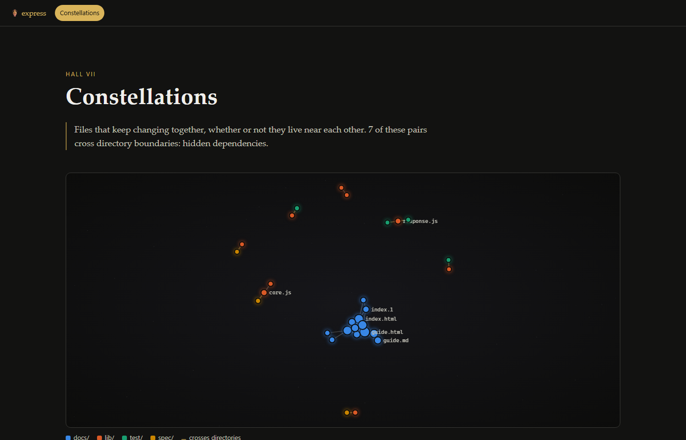
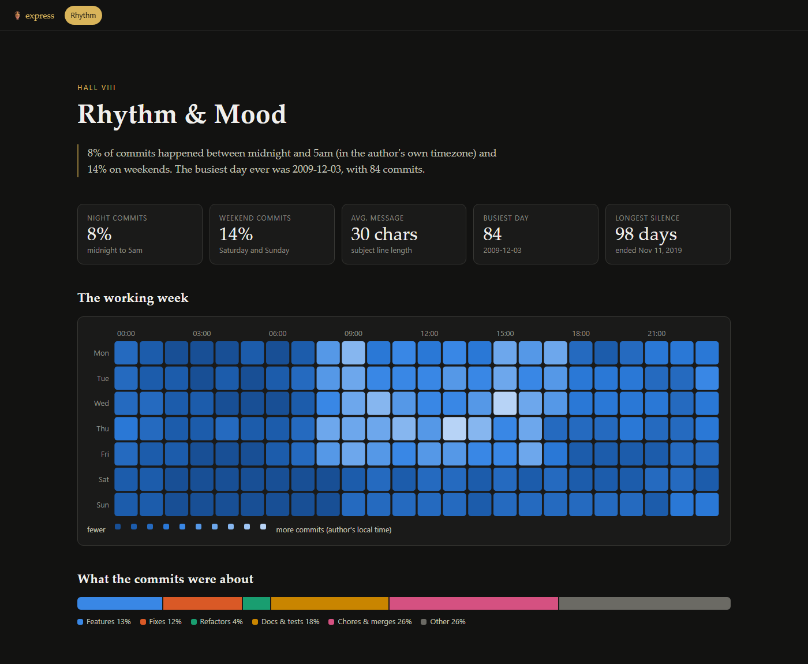

# 🏺 Code Archaeologist

> Dig up the hidden history of any git repository and exhibit it as an explorable web museum.

[](https://github.com/M0hid-ai/code-archaeologist/actions/workflows/ci.yml)


Point it at a repository and it reconstructs the story of the codebase: the eras it lived
through, the functions that survived dozens of refactors, the files that died (with
epitaphs), the battles fought over hotspots, and a timelapse of the whole thing growing.
The result is a **single self-contained `index.html`** you can open offline, host anywhere,
or send to your team.

**[See the live demo: the museum of Express.js →](https://m0hid-ai.github.io/code-archaeologist/demo/express/)**



## Quick start

```bash
git clone https://github.com/M0hid-ai/code-archaeologist
cd code-archaeologist
npm install && npm run build

node dist/src/bin.js /path/to/your/repo --open
# or excavate straight from a URL
node dist/src/bin.js https://github.com/expressjs/express -o express-museum
```

Or install the `codearch` command globally with `npm install -g .`.

## The wings of the museum

| Wing | What you'll find |
| --- | --- |
| **Entrance Hall** | The prologue, headline numbers and the languages that survive today. |
| **I. The Timeline** | Every month as a stacked bar (features, fixes, refactors, docs, chores), shaded **eras** with names derived from what actually happened ("The Bug Wars", "The Great Purge", "The Renaissance"...), release ticks and milestone plaques. |
| **II. The Timelapse Theater** | An animated, interpolated treemap of every file growing, shrinking and dying, grouped by directory. Scrub through time, change speed, and switch on the sound design (a chime per month pitched by activity, a low thud when files die). |
| **III. The Hall of Survivors** | Functions that have survived the most commits and refactors (found with `git blame` plus multi-language definition detection), **code strata** showing which year each surviving line was written in, the oldest living files and untouched fossils. |
| **IV. The Battlefield** | Hotspots ranked by churn × authors × bug fixes × recency, **tug-of-war rivalries** (A edits, B edits, A edits back within a month), earthquakes (the biggest single commits) and every revert with its regret time. |
| **V. The Graveyard** | A tombstone for every deleted file, with lifespan, killer, cause of death, last words and an epitaph. Plus massacres, reapers and **zombies** (files that came back from the dead). |
| **VI. The Portrait Gallery** | Every contributor with an identicon, activity sparkline and archetype badges: Founder, Titan, Architect, Janitor, Firefighter, Night Owl, Comet, Ghost... |
| **VII. Constellations** | A star map of files that keep changing together, highlighting hidden cross-directory dependencies. |
| **VIII. Rhythm & Mood** | A weekday × hour heatmap in each author's own timezone, what the commits were about, favourite first words and the Hall of Shame (`"misc"`, `"wip"`, `"."`). |
| **IX. The Archive** | A searchable, filterable record of recent commits. |

<details>
<summary>More screenshots</summary>










</details>

## AI narration (optional)

Everything works offline: a template-driven curator writes the prologue, era stories and
placards from the data. For richer wall texts, set an API key and the curator becomes a model:

```bash
export ANTHROPIC_API_KEY=...   # uses Claude (claude-opus-5-5 by default)
export GEMINI_API_KEY=...      # or Gemini (gemini-2.5-flash by default)

codearch . --ai auto           # default: Claude if available, then Gemini, else offline
codearch . --ai claude --model claude-sonnet-5-5
codearch . --ai none           # never call a model
```

Only an aggregate digest is sent (era statistics, file paths, names, commit subjects of
milestones). **Source code and email addresses are never sent**, and email addresses never
appear in the generated page either. If the model call fails for any reason, the museum
falls back to offline narration.

## CLI reference

```
codearch [repo] [options]

  repo                   Local path (default: .) or a git URL to clone
  -o, --out <dir>        Output directory (default: ./museum)
      --ai <mode>        auto | claude | gemini | none (default: auto)
      --model <id>       Model to narrate with
  -n, --max-commits <n>  Only excavate the most recent n commits
      --since <date>     Only commits after this date ("2 years ago", 2021-01-01)
      --ref <rev>        Branch, tag or commit to excavate (default: HEAD)
      --blame-files <n>  Files to excavate with git blame (default: 150)
      --json             Also write report.json (the full catalogue)
      --open             Open the museum in your browser when done
  -q, --quiet            Only print the output path
```

Append `?wings=graveyard,gallery` to the museum URL to show only some wings (handy for embedding).

## How it works

1. **Ingestion.** One streaming pass over `git log --raw --numstat -M`, parsed incrementally, so
   histories with hundreds of thousands of commits never sit in memory as one string. Author
   names honour `.mailmap`, and aliases that share an email or name are merged.
2. **Lifecycle replay.** Every file is followed from birth to death through renames and copies,
   with line counts sampled at each timelapse frame.
3. **Analysis passes.** Eras (dormancy gaps, then splits balanced between commit volume and time),
   graveyard, battlefield, contributors, coupling, rhythm and milestones are pure functions over
   that replay. Release bookkeeping (changelogs, manifests, CI config, lockfiles, build output) is
   kept out of rankings where it would drown the signal.
4. **Excavation.** `git blame` on a sample of living code files (oldest, most-edited and a fair
   random sample) feeds function survival and the code strata.
5. **Narration.** Offline templates, optionally replaced by Claude or Gemini.
6. **Rendering.** The catalogue is embedded as JSON in a single HTML file with inline CSS and
   vanilla JS. No frameworks, no network requests, no build step for the page.

Charts use a colour-blind-validated categorical palette, never encode meaning by colour alone,
and each has a table view.

## Development

```bash
npm install
npm test          # builds, then runs the node:test suite (unit + integration on scripted repos)
npm run museum -- . --open   # excavate this very repository
```

Project layout:

```
src/git/        log parsing, history reading, blame
src/analysis/   lifecycle replay and every exhibit's analysis
src/narrate/    offline curator and Claude / Gemini narration
src/render/     single-file site renderer
web/            template, stylesheet and one script per wing
test/           node:test suites and a scripted git fixture
```

See [CONTRIBUTING.md](CONTRIBUTING.md) for how to add a new wing.

## License

[MIT](LICENSE) © Mohid Fida
